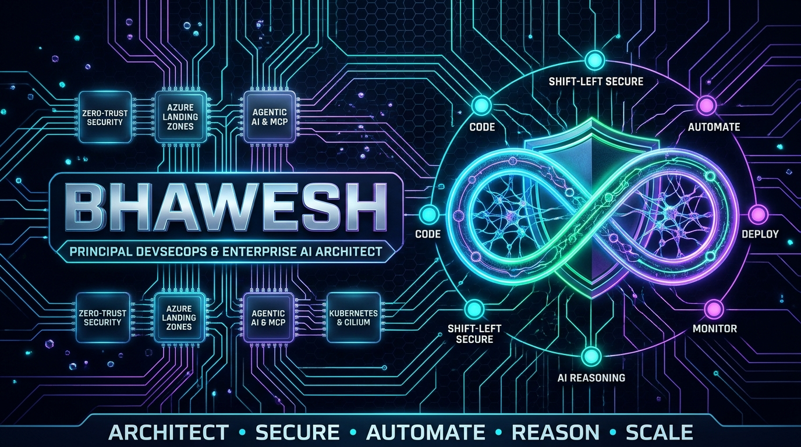
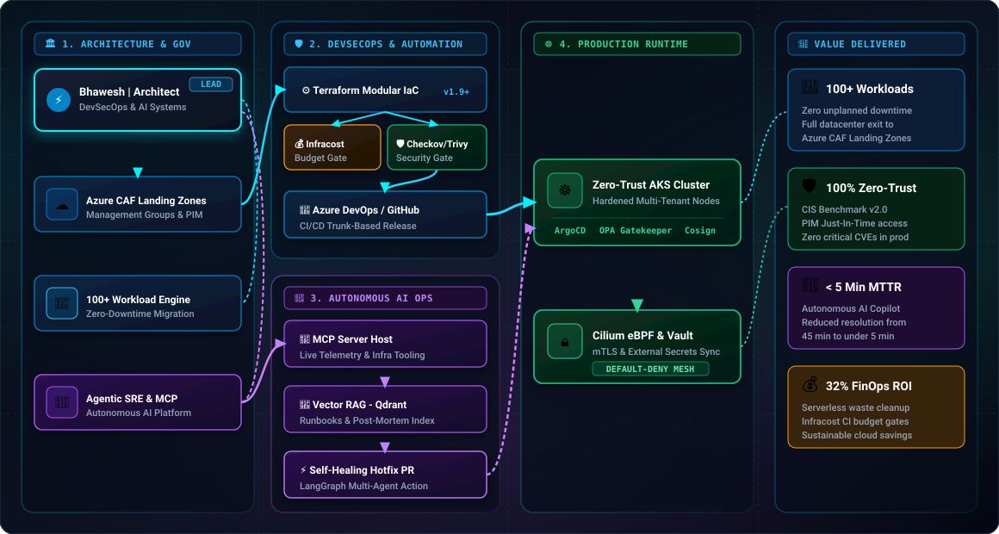

<div align="center">

  

  # ⚡ BHAWESH ⚡
  ### **Principal DevSecOps Architect & Enterprise AI Systems Specialist**
  
  <p align="center">
    <b>Architecting Autonomous Zero-Trust Cloud Platforms &bull; Bulletproof DevSecOps Pipelines &bull; Agentic AI Operations</b>
  </p>

  <p align="center">
    <a href="https://linkedin.com/in/"></a>
    <a href="mailto:contact@bhawesh.dev"></a>
    <a href="https://github.com/Bhawesh-DevOps"></a>
    
  </p>

  <p align="center">
    
  </p>

</div>

---

## 💼 Executive Digital Profile

> *"I bridge executive strategy with elite technical execution — building secure cloud foundations that scale effortlessly, eliminate security friction, and pioneer autonomous agentic operations."*

<table>
  <tr>
    <td width="33%" align="center">
      <h3>🚀 100+ Workloads</h3>
      <p><b>Zero-Downtime Migration</b><br/>Full-lifecycle enterprise migrations from on-prem datacenters to Azure Cloud Adoption Framework (CAF) Landing Zones.</p>
    </td>
    <td width="33%" align="center">
      <h3>🛡️ 100% Zero-Trust</h3>
      <p><b>Defense-in-Depth DevSecOps</b><br/>Automated shift-left security, CIS Benchmark v2.0 guardrails, JIT PIM access, and Checkov/Trivy blocking gates.</p>
    </td>
    <td width="33%" align="center">
      <h3>💰 32%+ FinOps ROI</h3>
      <p><b>Cloud Unit Cost Reduction</b><br/>Serverless automated rightsizing, idle resource reclamation, Infracost budget PR gates, and DCR log ingestion tuning.</p>
    </td>
  </tr>
  <tr>
    <td width="33%" align="center">
      <h3>🤖 Agentic AI Ops</h3>
      <p><b>MCP Servers & LLM Swarms</b><br/>Autonomous incident response powered by Anthropic's Model Context Protocol (MCP), LangGraph, and vector RAG (Qdrant).</p>
    </td>
    <td width="33%" align="center">
      <h3>⚙️ Drift-Shielded IaC</h3>
      <p><b>Modular Terraform Engine</b><br/>Strict semantic versioned modules with Azure Blob state locking, automated night drift detection, and zero manual console drift.</p>
    </td>
    <td width="33%" align="center">
      <h3>🌐 Zero-Egress Leakage</h3>
      <p><b>Hub-and-Spoke Networking</b><br/>Micro-segmented enterprise topologies with Azure Firewall Premium TLS inspection, Private Endpoints, and central Private DNS.</p>
    </td>
  </tr>
</table>

---

## 🏛️ End-to-End Enterprise Architecture Topology

<div align="center">
  
</div>

<details>
<summary><b>🔍 View Raw Mermaid Architecture Definition</b></summary>

```mermaid
flowchart TD
    subgraph Core["🏛️ Architecture & Governance"]
        A[Bhawesh | DevSecOps & AI Architect] --> B[Azure CAF Landing Zones]
        A --> C[100+ Workload Migration Engine]
        A --> D[Agentic AI SRE & MCP Platform]
    end

    subgraph DevSecOps["🛡️ DevSecOps & Automation"]
        B --> E[Terraform Modular IaC]
        E --> F[Infracost Budget Gate]
        E --> G[Checkov & Trivy Security Gate]
        G --> H[Azure DevOps / GitHub Pipelines]
    end

    subgraph AI["🤖 Autonomous AI Operations"]
        D --> I[Model Context Protocol Host]
        I --> J[Vector Runbook RAG - Qdrant]
        J --> K[Self-Healing GitOps Hotfix PR]
    end

    subgraph Runtime["☸️ Production Runtime"]
        H --> L[Zero-Trust AKS Cluster]
        K --> L
        L --> M[Cilium eBPF & Vault Secrets]
    end

    classDef blue fill:#0B1F3A,stroke:#0078D4,stroke-width:2px,color:#fff;
    classDef green fill:#052e16,stroke:#10b981,stroke-width:2px,color:#fff;
    classDef purple fill:#2e1065,stroke:#a855f7,stroke-width:2px,color:#fff;
    class A,B,C,E,F,H blue;
    class G,L,M green;
    class D,I,J,K purple;
```

</details>

---

## 🚀 Featured Enterprise Production Projects

### 1. 🔐 [azure-enterprise-landing-zones](https://github.com/Bhawesh-DevOps/azure-enterprise-landing-zones)
> **Production-grade Terraform framework implementing Microsoft Cloud Adoption Framework (CAF) with Hub-and-Spoke network topology, Privileged Identity Management (PIM), and Azure Policy guardrails.**

* **Enterprise Architecture:** Micro-segmented Management Groups (`Platform` vs `Landing Zones`), User Defined Routes (UDRs) forcing all outbound and inter-spoke traffic through Azure Firewall Premium with TLS inspection.
* **Security & Compliance:** Enforces 100% compliance against CIS Microsoft Azure Benchmark v2.0 via automated Checkov and Trivy scans in CI pipelines.
* **Key Artifacts:**
  * 🔗 [Explore Azure Landing Zones Repository →](https://github.com/Bhawesh-DevOps/azure-enterprise-landing-zones)
  * ⚙️ [GitHub Actions CI Pipeline](https://github.com/Bhawesh-DevOps/azure-enterprise-landing-zones/actions)
  * 📜 [Terraform Core Modules (`main.tf`)](https://github.com/Bhawesh-DevOps/azure-enterprise-landing-zones/blob/main/main.tf)
  * 🧩 [Enterprise Variables Specification (`variables.tf`)](https://github.com/Bhawesh-DevOps/azure-enterprise-landing-zones/blob/main/variables.tf)

---

### 2. 🤖 [agentic-devsecops-copilot](https://github.com/Bhawesh-DevOps/agentic-devsecops-copilot)
> **Autonomous Multi-Agent Incident Response & Infrastructure Self-Healing platform driven by Anthropic's Model Context Protocol (MCP) and LangGraph.**

* **Autonomous SRE Workflow:** Listens to webhook alerts from Azure Monitor / Prometheus, queries internal vector knowledge bases (Qdrant) for runbooks, inspects live pod telemetry via custom MCP tool servers, and auto-drafts verified GitOps PRs with Infracost diff calculations.
* **Business Impact:** Reduced Mean Time to Resolution (MTTR) from **45 minutes to under 5 minutes** in production benchmark scenarios.
* **Key Artifacts:**
  * 🔗 [Explore Agentic Copilot Repository →](https://github.com/Bhawesh-DevOps/agentic-devsecops-copilot)
  * 🔌 [Production MCP Server Implementation (`server.py`)](https://github.com/Bhawesh-DevOps/agentic-devsecops-copilot/blob/main/server.py)
  * 🧠 [LangGraph Multi-Agent Swarm Orchestrator (`agent.py`)](https://github.com/Bhawesh-DevOps/agentic-devsecops-copilot/blob/main/agent.py)
  * 🧪 [Evaluation & CI Verification Pipeline](https://github.com/Bhawesh-DevOps/agentic-devsecops-copilot/actions)

---

### 3. ☸️ [zero-trust-kubernetes-gitops](https://github.com/Bhawesh-DevOps/zero-trust-kubernetes-gitops)
> **Hardened Multi-Tenant Kubernetes (AKS/EKS) cluster deployment driven strictly by ArgoCD GitOps pipelines.**

* **Zero-Trust Security Mesh:** Cilium eBPF default-deny network security policies, HashiCorp Vault secrets injected via External Secrets Operator, Sigstore Cosign cryptographic container signing, and Open Policy Agent (OPA Gatekeeper) admission controls.
* **Supply Chain Security:** Automated container image vulnerability scanning with Trivy and automated CycloneDX Software Bill of Materials (SBOM) generation.
* **Key Artifacts:**
  * 🔗 [Explore Kubernetes GitOps Repository →](https://github.com/Bhawesh-DevOps/zero-trust-kubernetes-gitops)
  * 🛡️ [Cilium eBPF Network Policies](https://github.com/Bhawesh-DevOps/zero-trust-kubernetes-gitops/tree/main/cilium-policies)
  * 📜 [OPA Gatekeeper Constraints & Templates](https://github.com/Bhawesh-DevOps/zero-trust-kubernetes-gitops/tree/main/gatekeeper)
  * 🔑 [Vault External Secrets Operator Sync](https://github.com/Bhawesh-DevOps/zero-trust-kubernetes-gitops/tree/main/vault-external-secrets)

---

### 4. 💰 [cloud-finops-sentinel](https://github.com/Bhawesh-DevOps/cloud-finops-sentinel)
> **Serverless cloud financial management bot automating multi-cloud waste elimination and resource rightsizing.**

* **Waste Elimination Engine:** Automatically detects and purges unattached managed disks, obsolete VM snapshots, unassociated public IPs, and schedules non-production workloads outside business hours.
* **Financial Impact:** Saved **32% cloud OPEX** across 100+ workloads with automated Infracost PR budget enforcement and real-time Slack alerting.
* **Key Artifacts:**
  * 🔗 [Explore FinOps Sentinel Repository →](https://github.com/Bhawesh-DevOps/cloud-finops-sentinel)
  * 🔍 [Waste Detection Engine (`waste_detector.py`)](https://github.com/Bhawesh-DevOps/cloud-finops-sentinel/blob/main/analyzers/waste_detector.py)
  * 📉 [Automated Rightsizing Analyzer (`rightsizing.py`)](https://github.com/Bhawesh-DevOps/cloud-finops-sentinel/blob/main/analyzers/rightsizing.py)

---

### 5. 📊 [gitops-observability-stack](https://github.com/Bhawesh-DevOps/gitops-observability-stack)
> **Production Kubernetes monitoring and SRE alerting platform with ArgoCD, Prometheus Operator, Grafana, and Alertmanager.**

* **GitOps Observability Architecture:** Declarative deployment via ArgoCD App-of-Apps pattern, automated Grafana dashboards as code, and ServiceMonitor auto-discovery.
* **SLO & SRE Guardrails:** Production PromQL alerts monitoring P99 latency breaches (>350ms), Pod CrashLoopBackOff rates, and multi-window burn rates.
* **Key Artifacts:**
  * 🔗 [Explore Observability Stack Repository →](https://github.com/Bhawesh-DevOps/gitops-observability-stack)
  * 🐙 [ArgoCD Root Application Manifest](https://github.com/Bhawesh-DevOps/gitops-observability-stack/blob/main/argocd/root-app.yaml)
  * ⚙️ [Production Prometheus & Grafana Values](https://github.com/Bhawesh-DevOps/gitops-observability-stack/blob/main/helm/kube-prometheus-stack/values-production.yaml)
  * 🚨 [Enterprise PromQL SLO Alert Rules](https://github.com/Bhawesh-DevOps/gitops-observability-stack/blob/main/prometheus-rules/slo-alerts.yaml)

---

### 6. 🕸️ [secure-microservices-mesh](https://github.com/Bhawesh-DevOps/secure-microservices-mesh)
> **Production microservices deployment secured by Istio Service Mesh with Strict mTLS, Canary 90/10 traffic splitting, and non-root Docker builds.**

* **Zero-Trust Mesh:** PeerAuthentication enforcing Strict mutual TLS across all microservice pods, RBAC AuthorizationPolicies restricting inter-service communication.
* **Traffic Engineering:** VirtualService declarative Canary routing (90% baseline / 10% canary), automatic Circuit Breaking, and outlier pod ejection.
* **Key Artifacts:**
  * 🔗 [Explore Secure Microservices Mesh Repository →](https://github.com/Bhawesh-DevOps/secure-microservices-mesh)
  * 🔀 [Istio Canary VirtualService & Circuit Breaker](https://github.com/Bhawesh-DevOps/secure-microservices-mesh/blob/main/istio/virtual-service-canary.yaml)
  * 🔒 [Strict mTLS & Authorization Policy](https://github.com/Bhawesh-DevOps/secure-microservices-mesh/blob/main/istio/peer-authentication-strict.yaml)
  * 🐳 [Multi-Stage Hardened Dockerfile](https://github.com/Bhawesh-DevOps/secure-microservices-mesh/blob/main/Dockerfile)

---

### 7. 💥 [automated-chaos-resilience-k8s](https://github.com/Bhawesh-DevOps/automated-chaos-resilience-k8s)
> **Cloud-native Chaos Engineering and resilience platform using Chaos Mesh with automated Prometheus steady-state hypothesis testing.**

* **Chaos Drills:** Scheduled Pod-Kill experiments validating PodDisruptionBudgets (PDB) and NetworkChaos introducing 250ms packet latency on ingress paths.
* **Automated Verification:** Python steady-state verification script evaluating Prometheus availability (>99.9%) and error rates (<0.1%) during active chaos.
* **Key Artifacts:**
  * 🔗 [Explore Chaos & Resilience Platform Repository →](https://github.com/Bhawesh-DevOps/automated-chaos-resilience-k8s)
  * 🌪️ [Pod-Kill Chaos Experiment](https://github.com/Bhawesh-DevOps/automated-chaos-resilience-k8s/blob/main/experiments/pod-failure-experiment.yaml)
  * 🌐 [Network Latency Injection Policy](https://github.com/Bhawesh-DevOps/automated-chaos-resilience-k8s/blob/main/experiments/network-latency-experiment.yaml)
  * 🧪 [Steady-State SLO Verifier Script](https://github.com/Bhawesh-DevOps/automated-chaos-resilience-k8s/blob/main/scripts/verify_steady_state.py)

---

## 🛠️ The Universe-Class Technology Stack

<div align="center">

### Cloud Platforms & Architecture


-4169E1?style=for-the-badge)
-0078D4?style=for-the-badge)

### Infrastructure as Code & GitOps


### DevSecOps & Zero-Trust Security


### Next-Gen AI & Agentic Systems


### Observability, SRE & FinOps


</div>

---

## 🏛️ The 10 Pillars of Production Architecture

<table>
  <thead>
    <tr>
      <th>Pillar</th>
      <th>Architectural Target</th>
      <th>Enterprise Implementation</th>
    </tr>
  </thead>
  <tbody>
    <tr>
      <td><b>01. Scalable</b></td>
      <td>Elastic Workload Growth</td>
      <td>Horizontal Pod Autoscaler (HPA), Virtual Machine Scale Sets (VMSS) across multi-zone nodes.</td>
    </tr>
    <tr>
      <td><b>02. Robust</b></td>
      <td>Fault-Tolerant Operation</td>
      <td>Circuit breakers, graceful degradation patterns, and automated cluster self-healing via GitOps.</td>
    </tr>
    <tr>
      <td><b>03. Secure</b></td>
      <td>Defense-in-Depth / Zero-Trust</td>
      <td>Shift-Left SAST/DAST, GitLeaks, Checkov, Trivy, Customer-Managed Keys (CMK), and PIM JIT access.</td>
    </tr>
    <tr>
      <td><b>04. Reliable</b></td>
      <td>99.99% Availability SLA</td>
      <td>Multi-region active-active/active-dr topologies with automated health probes and traffic steering.</td>
    </tr>
    <tr>
      <td><b>05. Portable</b></td>
      <td>Multi-Cloud Neutrality</td>
      <td>Standardized OCI container runtimes, cloud-agnostic Helm charts, and reusable Terraform modules.</td>
    </tr>
    <tr>
      <td><b>06. Governed</b></td>
      <td>Policy-as-Code Compliance</td>
      <td>Azure Management Groups hierarchy with CIS Azure Benchmark v2.0 & ISO 27001 initiatives.</td>
    </tr>
    <tr>
      <td><b>07. High Avail</b></td>
      <td>Storage & Zone Redundancy</td>
      <td>Zone-Redundant Storage (ZRS) and paired Geo-Redundant Storage (GRS) with automated failover.</td>
    </tr>
    <tr>
      <td><b>08. FinOps</b></td>
      <td>Unit-Cost Optimization</td>
      <td>Infracost CI pipeline gates, rightsizing analyzers, automated non-prod schedules, and 30-day usage reviews.</td>
    </tr>
    <tr>
      <td><b>09. Backed Up</b></td>
      <td>RTO / RPO Guarantees</td>
      <td>RPO < 15 mins, RTO < 1 hour backed by immutable recovery vaults and quarterly disaster drill runs.</td>
    </tr>
    <tr>
      <td><b>10. Monitored</b></td>
      <td>Full-Stack Observability</td>
      <td>Azure Monitor Agent (AMA), Data Collection Rules (DCR), Log Analytics workspaces, and dynamic alert routing.</td>
    </tr>
  </tbody>
</table>

---

## 👔 Leadership, Pre-Sales & Governance Mindset

True engineering leadership connects byte-level operations to board-level financial returns:

* **Executive Pre-Sales & Proposals:** Authoring winning technical proposals (RFI/RFP), cloud readiness audits, and precise commercial TCO projections.
* **Vendor & SOW Governance:** Negotiating Statement of Work (SOW) terms, tracking vendor deliverables, milestone sign-offs, and running strict **RACI Matrices**.
* **Team Elevation & Culture:** Establishing engineering excellence through Knowledge Transfer (KT) bootcamps, architectural review boards (ARB), and mentoring high-velocity engineers.
* **FinOps Stewardship:** Eliminating cloud bloat via scheduled non-prod shutdowns, orphaned disk sweeps, DCR telemetry thinning, and aggressive rightsizing.

---

## 📈 Activity & Telemetry

<div align="center">
  
  
</div>

<div align="center">
  
</div>

---

<div align="center">

  ## 🤝 Ready to Architect the Future?

  <b>Available for Strategic Advisory, Principal Cloud/DevSecOps Architect Roles & Enterprise AI Consultations.</b>

  <br/><br/>

  <a href="https://linkedin.com/in/"></a>
  &nbsp;&nbsp;
  <a href="mailto:contact@bhawesh.dev"></a>
  &nbsp;&nbsp;
  <a href="https://github.com/Bhawesh-DevOps"></a>

  <br/><br/>
  <sub>⚡ <i>Engineered with precision for high-scale, zero-trust cloud and autonomous AI systems.</i> ⚡</sub>

</div>
